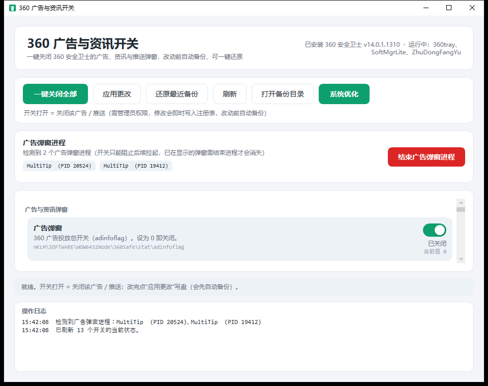
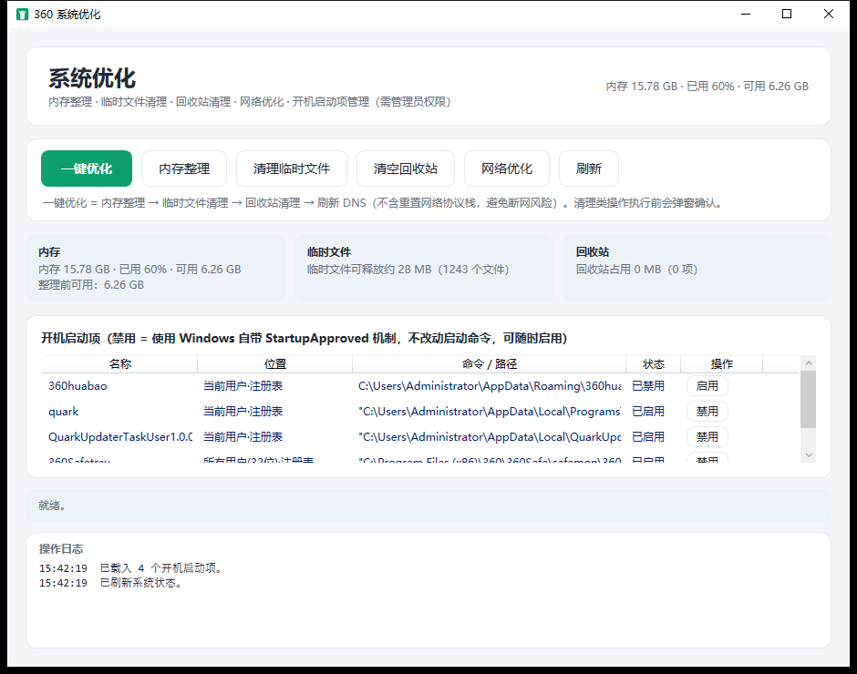

# 360PopupCleaner

> 360 安全卫士**广告 / 资讯弹窗一键关闭** + **系统优化**工具 —— 单文件绿色发布

一个基于 **WPF / .NET Framework 4.7.2** 的 Windows 桌面工具，**零第三方依赖**，编译产物为**单个 exe**，可直接拷贝运行、无需安装。

- **关闭 360 广告与资讯弹窗**：把 360 安全卫士的广告、资讯、推广推送开关写入注册表（`HKLM\SOFTWARE\WOW6432Node\360Safe`），一键关闭、改动前自动备份、可一键还原。
- **结束已弹出的广告窗口**：检测并结束 360 常驻的广告弹窗进程（`sesvcr.exe` / `MultiTip.exe` / `webapp.exe` 等）。
- **系统优化**：内存整理、临时文件清理、回收站清理、网络优化、开机启动项管理。

---

## 下载

无需自行编译，直接下载单文件程序即可使用。

- **直接下载（本仓库）**：[`dist/360PopupCleaner.exe`](dist/360PopupCleaner.exe)
- **Releases 页面**：[最新版本](https://github.com/aiweisoft/360PopupCleaner/releases)

> **运行要求**：Windows 7 SP1 及以上 + .NET Framework 4.7.2（Windows 10 / 11 已内置 4.8，通常无需额外安装）。
> 程序需要**管理员权限**，启动时会弹出 UAC 提权。

---

## 界面预览

| 广告与资讯开关（主界面） | 系统优化 |
| --- | --- |
|  |  |

---

## 功能

### 一、广告与资讯开关（13 项）

主界面列出全部已知开关，每一项都**透明展示对应的注册表路径与值名**。开关打开 = 关闭该广告 / 推送。点「一键关闭全部」后可「应用更改」写盘（会先自动备份）。

| 分组 | 开关 | 注册表值 | 说明 | 来源 |
| --- | --- | --- | --- | --- |
| 广告与资讯弹窗 | 广告弹窗 | `stat\adinfoflag` | 广告投放总开关，设为 0 关闭 | 本机实测 |
| 广告与资讯弹窗 | 资讯 / 热点弹窗 | `stat\newsinfoflag` | 资讯与热点推送开关 | 本机实测 |
| 广告与资讯弹窗 | 加速球广告位 | `stat\speedld_ad` | 桌面加速球内嵌广告位 | 本机实测 |
| 广告与资讯弹窗 | 安全首页资讯 | `examinui\HomeNews` | 首页资讯 / 看点模块 | 本机实测 |
| 推广 / 提示 | 加速球健康提醒 | `stat\show_speedldhealth` | 加速球健康 / 体检提醒 | 本机实测 |
| 推广 / 提示 | 性能 / 清理提醒 | `stat\perf_remind_show` | 性能占用与"该清理了"提醒 | 本机实测 |
| 推广 / 提示 | 视频下载提示 | `stat\videodltip` | 检测到视频时的下载提示 | 本机实测 |
| 推广 / 提示 | 看图推广提示 | `stat\kantu` | 看图相关推广提示 | 本机实测 |
| 推广 / 提示 | 安卓应用提示 | `stat\apktip` | 安卓 / APK 相关提示 | 本机实测 |
| 首页与软件管家 | 软件管家新版推荐 | `softmgr\softmgr_shownew` | 软件管家新软 / 新版本推广 | 本机实测 |
| 首页与软件管家 | 软件管家天气推送 | `softmgr\ptweather` | 软件管家面板天气推送 | 本机实测 |
| 实验性 | 弹窗过滤伪装 | `stat\noadpop` | 写入 1，让 360 认为已开启弹窗过滤 | 第三方参考 |
| 实验性 | 弹窗追踪器开关 | `stat\advtool_PopWndTracker` | 写入 1，配合上面的伪装 | 第三方参考 |

> **实验性**两项参考自开源项目 [`AzureIvory/block-ads`](https://github.com/AzureIvory/block-ads)，效果未逐一验证，默认不参与「一键关闭全部」，请谨慎使用。

> 开关只负责"**以后不再拉起**"弹窗；**已经在屏幕上的弹窗**需要靠下面的进程结束功能才会消失。

### 二、广告弹窗进程检测与结束

- 自动检测 360 常驻的广告弹窗进程，按**进程名白名单**（`sesvcr` / `MultiTip` / `webapp` / `360DayPop` / `360newsld` / `360SpeedldHealth`）+ **目录规则**（exe 位于 `%APPDATA%\360safe\SoftMgr` 下）识别。
- 界面列出每个进程的 **PID**，一键「结束广告弹窗进程」全部结束。
- 实测：底部右下角广告弹窗由 `sesvcr.exe`（窗口类 `mininews`）渲染，结束进程后立即消失。

### 三、系统优化

独立窗口（主界面工具栏「系统优化」按钮打开），含分项按钮 + 「一键优化」。

| 功能 | 说明 | 风险 |
| --- | --- | --- |
| **内存整理** | 清空各进程工作集（`EmptyWorkingSet`）+ 清空系统待机内存列表（Standby List） | 低 |
| **临时文件清理** | 清理 `%TEMP%`、`C:\Windows\Temp`、`INetCache`；先扫描显示可释放大小，占用中的文件自动跳过 | 低 |
| **回收站清理** | 清空回收站，执行前显示占用大小并确认 | 中 |
| **网络优化** | 刷新 DNS 缓存 + 重置 Winsock + 重置 TCP/IP（**需重启才完全生效**，执行前确认） | 中 |
| **开机启动项管理** | 列出注册表 Run（HKCU / HKLM / WOW6432Node）+ 启动文件夹的全部启动项，支持禁用 / 启用 | 低 |
| **一键优化** | 内存整理 → 临时文件清理 → 回收站清理 → 刷新 DNS（**不含**重置网络协议栈，避免断网风险） | — |

- 实测内存整理：可用内存 **2.57 GB → 8.44 GB（+5.86 GB）**。
- 实测临时文件清理：删除 2958 个文件、释放 29 MB，14 个占用文件正确跳过。

---

## 安全与可逆

- **改动前自动备份**：每次「应用更改」前，把将被改动的注册表原值（含时间戳值）导出为 JSON，保存到
  `%LOCALAPPDATA%\360PopupCleaner\backups\<yyyyMMdd-HHmmss>.json`。
- **一键还原**：主界面「还原最近备份」可把注册表恢复到备份时的状态。
- **启动项禁用非破坏性**：使用 Windows 自带的 `Explorer\StartupApproved` 机制（写入 12 字节二进制，`02`=启用 / `03`=禁用），**不改动启动命令本身**，与任务管理器行为一致，可随时启用。
- 所有写操作都需要管理员权限。

---

## 编译

需要 **Visual Studio 2019/2022**（含 .NET 桌面开发工作负载）。

```bat
:: 命令行编译（MSBuild）
msbuild 360PopupCleaner.sln /t:Rebuild /p:Configuration=Release

:: 生成产物
:: src\360PopupCleaner\bin\Release\360PopupCleaner.exe
```

> 工程使用通配符包含源文件（`<Compile Include="**\*.cs" />`），新增 `.cs` / `.xaml` 无需手动改 csproj。

---

## 目录结构

```
360PopupCleaner.sln
src/360PopupCleaner/
├─ App.xaml(.cs)              应用入口与资源字典
├─ MainWindow.xaml(.cs)       主界面：广告开关 + 广告进程
├─ SystemOptimizeWindow.xaml(.cs)  系统优化窗口
├─ app.manifest               requireAdministrator 提权清单
├─ Themes/Theme.xaml          统一配色与控件样式
├─ Converters/                值转换器
├─ Models/
│  ├─ ToggleDefinition/Catalog   开关定义与清单
│  ├─ RegistryAccess             注册表读写
│  ├─ BackupManager              备份 / 还原（JSON）
│  ├─ Detector                   360 安装与进程检测
│  ├─ AdProcessScanner           广告弹窗进程检测与结束
│  ├─ MemoryOptimizer            内存整理
│  ├─ TempCleaner                临时文件清理
│  ├─ RecycleBinCleaner          回收站清理
│  ├─ NetworkOptimizer           网络优化
│  └─ StartupManager             开机启动项管理
└─ ViewModels/                MVVM 视图模型
```

---

## 免责声明

- 本项目为**个人学习与自用**工具，与 360 官方无任何关联。
- 注册表开关的键值取自本机 **360 安全卫士 14.0.1.1310** 的实测结果，**不同版本可能存在差异**；使用前请先「还原最近备份」确认可回退。
- 请自行评估风险后使用，作者不对因使用本工具造成的任何损失负责。
